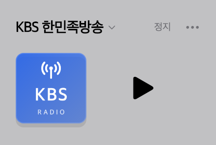
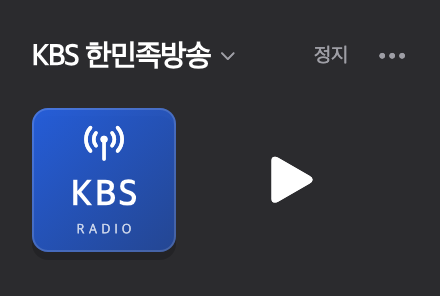

# mac_radio_kr

한국 라디오를 재생하는 macOS 메뉴 막대 앱입니다. Flutter와 AppKit으로 만들었습니다.

## 미리보기

| 라이트 모드 | 다크 모드 |
| :---: | :---: |
|  |  |

## 다운로드 및 설치

[최신 설치 ZIP](./설치파일/)을 다운로드하세요.

- 대상: Apple Silicon Mac (arm64)
- 요구 사항: macOS 14 이상

1. ZIP을 열고 `mac_radio_kr.app`을 압축 해제합니다.
2. 앱을 `응용 프로그램` 폴더로 옮깁니다.
3. 처음 실행할 때 Finder에서 앱을 Control-클릭하고 `열기`를 선택합니다.

앱은 공증되지 않았습니다. macOS에서 확인 메시지가 표시될 수 있습니다. Intel Mac에서는 실행할 수 없습니다.

`main`에 변경사항을 push하면 GitHub Actions가 버전을 올리고 설치 ZIP을 갱신합니다. 버전은 ZIP 파일명과 앱 정보에 표시됩니다.

## 사용 방법

- 메뉴 막대의 라디오 아이콘을 눌러 채널을 선택합니다.
- 첫 실행은 MBC FM4U를 정지 상태로 엽니다.
- 가운데 버튼으로 재생과 정지를 전환합니다.
- 패널을 닫아도 재생은 계속됩니다.
- 더보기 메뉴에서 앱을 종료합니다.
- 재생을 시작한 뒤 미디어 키와 macOS Now Playing으로 제어할 수 있습니다. 다시 재생하면 생방송에 연결합니다.

## 개발 실행

필요 항목: macOS 14 이상, Flutter 3.41 이상, Xcode, CocoaPods.

```sh
flutter pub get
flutter run -d macos
```

## 주요 기능

- 전국·지역별 방송사와 공동체 라디오 채널을 제공합니다.
- `just_audio`로 HLS 스트림을 재생합니다. 채널 변경과 재시도 때 재생 주소를 다시 조회합니다.
- CoreAudio로 시스템 볼륨, 음소거, 출력 장치 변경을 감지합니다. 앱 시작 시 시스템 볼륨은 바꾸지 않습니다.
- 볼륨 슬라이더는 시스템 출력을 조절합니다. 라디오 게인은 30%입니다. 조절을 지원하지 않는 장치에서는 슬라이더가 비활성화됩니다.
- `shared_preferences`에는 마지막 채널 ID만 저장합니다.
- 편성표와 선곡 정보는 제공하지 않습니다.

## 스트림 안내

- 방송사 API와 HLS에 직접 연결하며 중계 서버는 사용하지 않습니다.
- 방송사별 주소와 조회 방식은 [radio.bsod.kr](https://github.com/BSofDeath/radio.bsod.kr/tree/main/functions/stream/url)를 참고했습니다.
- 일부 HTTP 스트림은 암호화되지 않습니다.
- EBS는 온에어 페이지에서 재생 주소를 찾고, 실패하면 공식 HLS 주소를 시도합니다.
- 주소 조회나 연결에 실패한 채널은 목록에서 제외했습니다. 주소가 복구되면 다시 추가할 수 있습니다.
- 방송사 API와 페이지 변경에 따라 재생 주소 조회 코드의 수정이 필요할 수 있습니다.

## 검증 및 빌드

```sh
flutter analyze
flutter test
flutter test integration_test/radio_catalog_streams_test.dart -d macos
flutter test integration_test/radio_playback_test.dart -d macos
flutter test integration_test/system_volume_test.dart -d macos
flutter build macos --release
```

- 일반 테스트: 채널 목록, URL 파싱, 시간 제한, 재생 상태 전환을 확인합니다.
- 카탈로그·재생 통합 테스트: 실제 방송 주소와 macOS 오디오 엔진을 확인합니다. 재생 테스트는 음량 0으로 실행합니다.
- 시스템 볼륨 테스트: 볼륨을 잠시 0으로 바꾼 뒤 원래 값으로 복원합니다. 조절을 지원하지 않거나 음소거된 장치는 건너뜁니다.

Release 앱 경로: `build/macos/Build/Products/Release/mac_radio_kr.app`.

Release 빌드는 현재 Mac의 아키텍처를 사용합니다. Apple Silicon 빌드는 arm64용입니다. 앱은 로컬 서명만 적용하며 공증이나 스토어 배포는 포함하지 않습니다.
